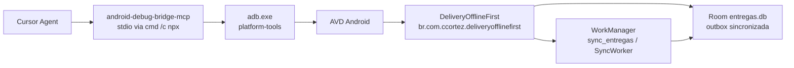

# Auditoria de runtime — ADB MCP no DeliveryOfflineFirst

Documento de governança da esteira de diagnóstico em emulador. O contrato abaixo foi confrontado com o código em `app/` (`applicationId`, Room, `SyncWorker`, `EntregasViewModel`, `EntregasScreen`). A coluna de runtime define o critério de aceite que o agente registra quando o servidor MCP está ligado a um AVD. Este arquivo não anexa uma sessão de emulador.

Identidade operacional:

| Item | Valor |
|---|---|
| `applicationId` / `namespace` | `br.com.ccortez.deliveryofflinefirst` |
| Activity | `br.com.ccortez.deliveryofflinefirst.MainActivity` |
| Banco Room | `entregas.db` (versão 4), tabela `entrega` |
| Outbox | `sincronizada = 0` até `marcarSincronizadaPorUuid` |
| Trabalho único | `sync_entregas` |
| Worker | `br.com.ccortez.deliveryofflinefirst.data.worker.SyncWorker` |
| Tag do ViewModel | `DEBUG_OFFLINE_FIRST` |

O `applicationId` publicado em `app/build.gradle.kts` é `br.com.ccortez.deliveryofflinefirst`. Comandos com outro pacote não atingem este processo.

## 1. Configuração do servidor MCP

Pacote: [`android-debug-bridge-mcp@2.1.0`](https://www.npmjs.com/package/android-debug-bridge-mcp) (TiagoDanin, MIT). Superfície estável com `adb_shell`, `read_logcat`, `toggle_wifi`, `toggle_airplane_mode` e inspeção de UI. A versão fica pinada para a esteira não mudar de ferramenta no meio de uma auditoria.

Arquivo recomendado: `.cursor/mcp.json` na raiz do repositório (escopo do projeto). O equivalente global é `%USERPROFILE%\.cursor\mcp.json`.

No Windows o Cursor inicia o servidor sem shell. `npx` resolve para `npx.cmd`, e o spawn direto de `npx` falha com `ENOENT`. O processo pai é `cmd /c`.

```json
{
  "mcpServers": {
    "android-debug-bridge": {
      "command": "cmd",
      "args": ["/c", "npx", "-y", "android-debug-bridge-mcp@2.1.0"],
      "env": {
        "ADB_PATH": "${env:LOCALAPPDATA}\\Android\\Sdk\\platform-tools\\adb.exe"
      }
    }
  }
}
```

Pré-requisitos: Node.js 18+, Android SDK platform-tools, um AVD em `adb devices` com estado `device`. Se o SDK não estiver em `%LOCALAPPDATA%\Android\Sdk`, apontar `ADB_PATH` para o `adb.exe` real ou definir `ANDROID_HOME`. Com vários aparelhos, incluir `ADB_SERIAL` (serial do `adb devices`, por exemplo `emulator-5554`).

Verificação: Cursor → Settings → MCP mostra o servidor habilitado e a lista de ferramentas. Saída em Output → MCP Logs. `adb-agent doctor` confirma binário, dispositivo e uiautomator.

### Ferramentas que o agente passa a ter

O servidor expõe 62 ferramentas. As que sustentam esta auditoria:

| Capacidade | Ferramenta MCP | Comando ADB correspondente |
|---|---|---|
| Shell arbitrário | `adb_shell` | `adb shell <comando>` |
| Logcat | `read_logcat`, `clear_logcat` | `adb logcat` |
| Process death | `adb_shell` → `am kill <pacote>` | `adb shell am kill` |
| Retomada da Activity | `adb_shell` → `am start -n …/.MainActivity` | `adb shell am start` |
| JobScheduler / WorkManager | `adb_shell` → `dumpsys jobscheduler` | `adb shell dumpsys jobscheduler` |
| Processo e memória | `list_processes`, `get_memory_usage` | `ps`, `dumpsys meminfo` |
| Wi-Fi | `toggle_wifi` | `svc wifi enable` / `disable` |
| Dados móveis | `toggle_mobile_data` | `svc data enable` / `disable` |
| Modo avião no AVD | `toggle_airplane_mode` | `cmd connectivity airplane-mode` |
| Prova de conectividade | `get_connectivity_state` | estado de wifi, dados e avião |
| UI e evidência visual | `capture_ui_dump`, `ui_find`, `ui_tap`, `capture_screenshot` | uiautomator / `screencap` |
| Inventário | `list_devices`, `device_info` | `adb devices -l` |

`adb_shell` é o escape hatch. Preferir a ferramenta dedicada quando ela existir: a saída vem estruturada. `stop_app` equivale a encerrar o pacote de forma forte (`force-stop`) e fica fora do cenário de process death.

## 2. Arquitetura da esteira



O agente não embute o ADB. Ele chama ferramentas MCP; o servidor traduz para `adb`; o daemon fala com o emulador. O app continua dono da regra de negócio: a UI observa Room, a conclusão grava o outbox, e o `SyncWorker` só promove `sincronizada` para 1 depois do ACK simulado.

Três depósitos de estado, com durabilidades diferentes:

| Depósito | Mecanismo no código | Sobrevive a rotação | Sobrevive a process death |
|---|---|---|---|
| Entregas e flag de sync | Room, `StateFlow` em `EntregasUiState` | Sim | Sim — releitura do banco |
| Busca (`searchQuery`) | `MutableStateFlow` no ViewModel | Sim (`EstadoPersistenciaTest` usa `recreate()`) | Não — o ViewModel morre com o processo |
| Anotação rápida | `rememberSaveable` → `SavedStateRegistry` | Sim | Sim, se o estado já foi salvo com a Activity parada |
| Snackbar | `MutableSharedFlow` sem replay | Não reaparece | Não reaparece |
| Fila de sync | WorkManager + Room | Sim | Sim |

Não há injeção de `SavedStateHandle` em `EntregasViewModel`. A restauração da lista depois do process death é o contrato de Clean Architecture (UI relê a fonte única), não um bundle de `UiState`.

## 3. Roteiros

Build: `./gradlew :app:installDebug`. O agente começa por `list_devices` e `clear_logcat`. Cada cenário termina com o fato bruto (PID, SQL, trecho de `dumpsys`, linhas de log). Sem dispositivo, o cenário para.

### 3.1 Process death e restauração de estado

Objetivo: matar o processo em cache, recriar a Activity e separar o que volta do Room, o que volta do `SavedStateRegistry` e o que o ViewModel não persiste.

1. Abrir a Activity: `adb_shell` `am start -n br.com.ccortez.deliveryofflinefirst/.MainActivity`.
2. Baseline de UI. Em `campo_busca`, digitar um termo (`Ana`). Em `Anotação rápida` (`campo_not_lived_in_viewmodel`), digitar um marcador (`portão azul`).
3. Baseline de banco (seção 3.2, passo da cópia). Anotar `COUNT(*)` e os ids com `sincronizada = 0`. A semente inclui `seed-4` / Maria Souza.
4. Enviar a Activity para stopped, para o sistema gravar o `SavedStateRegistry`: `input_keyevent` `KEYCODE_HOME`.
5. Encerrar só processos em cache:

   ```text
   adb shell am kill br.com.ccortez.deliveryofflinefirst
   adb shell pidof br.com.ccortez.deliveryofflinefirst
   ```

   PID vazio confirma a morte. PID presente significa que o app ainda estava em foreground; repetir o HOME e o `am kill`.
6. Subir de novo: `am start -n br.com.ccortez.deliveryofflinefirst/.MainActivity`.
7. Ler a UI (`capture_ui_dump` ou screenshot) e repetir a consulta SQL.

Aceite:

- A lista de entregas reaparece a partir do Room, com os mesmos ids e a mesma `sincronizada`.
- `Anotação rápida` contém o marcador.
- `campo_busca` volta vazio. Isso é o comportamento atual do `MutableStateFlow`, e o teste instrumentado de rotação não cobre este eixo.
- Nenhum snackbar de conclusão reaparece.

### 3.2 Resiliência do outbox offline

Objetivo: provar que a escrita local acontece sem rede e que o `SyncWorker` só drena com conectividade, respeitando o contrato de idempotência por UUID.

1. Confirmar rede útil com `get_connectivity_state`.
2. Cortar rádio: `toggle_wifi` desligado e `toggle_mobile_data` desligado. No AVD o tráfego costuma seguir por `eth0`; se o estado ainda mostrar rota, `toggle_airplane_mode` ligado.
3. Prova de corte: `adb_shell` `dumpsys connectivity` sem rede `VALIDATED` para o app, ou ping a `8.8.8.8` sem resposta.
4. Concluir uma entrega ainda pendente pela UI (cliente sem `sincronizada = 0`). O ViewModel chama `concluirEntrega` e `agendarSync`.
5. Ler o banco de um build debug. O `pull_file` do MCP não atravessa o sandbox; a cópia sai por `run-as`:

   ```text
   adb exec-out run-as br.com.ccortez.deliveryofflinefirst cat databases/entregas.db
   ```

   Se existirem `entregas.db-wal` e `entregas.db-shm`, copiar os três arquivos antes de abrir no SQLite local. Consulta:

   ```sql
   SELECT id, cliente, status, sincronizada, uuid
   FROM entrega
   WHERE sincronizada = 0;
   ```

6. Inspecionar o job:

   ```text
   adb shell dumpsys jobscheduler
   ```

   Filtrar `br.com.ccortez.deliveryofflinefirst`. Com rede ausente o trabalho `sync_entregas` fica enfileirado e a restrição de conectividade insatisfeita.
7. Ligar de novo wifi, dados e desligar o modo avião. Aguardar o backoff (piso de 30s se já houve `Result.retry`).
8. `read_logcat` / filtro da seção 3.3 na tag `SyncWorker`.

Aceite, um dos dois:

- Log `Sync complete` e as linhas drenadas com `sincronizada = 1`.
- Log `Simulated network failure — scheduling retry`: as linhas permanecem em `0` e o job volta a ser elegível. O worker sorteia falha em 30% de propósito; o outbox não é apagado antes do ACK. `ExistingWorkPolicy.KEEP` impede uma segunda fila concorrente.

`seed-4` já entra no outbox no primeiro insert. Ela serve de controle mesmo quando a UI não conclui outra entrega.

### 3.3 Triagem de logcat

`read_logcat` aplica um filtro de substring e um pacote. Para as tags do app ao mesmo tempo:

```text
adb logcat -d -v brief DEBUG_OFFLINE_FIRST:D SyncWorker:D Room:W SQLiteLog:W WM-WorkerWrapper:I WM-Processor:I FirebaseAppCheck:W DebugAppCheckProvider:D *:S
```

| Preocupação | Tag real | O que a linha significa |
|---|---|---|
| ViewModel, Remote Config, Analytics | `DEBUG_OFFLINE_FIRST` | `EntregasViewModel` não usa o nome da classe como tag |
| Drenagem do outbox | `SyncWorker` | vazio, POST simulado, retry de 30%, ou `Unexpected error during sync` |
| WorkManager | `WM-WorkerWrapper`, `WM-Processor` | estado do `sync_entregas`, backoff, constraint |
| Room | `Room`, `SQLiteLog` | migração, SQL inválido, exceção de escrita |
| App Check | `FirebaseAppCheck`, `DebugAppCheckProvider` | token de debug ausente ou rejeitado |

`reloadRemoteConfig` em cada `RESUMED` (`repeatOnLifecycle`) escreve `DEBUG_OFFLINE_FIRST` de novo. Isso é o contrato de atualização da feature flag, não um laço de recomposição. Sinal de pressão de frame: `Choreographer` com frames pulados. A tela já limita recomposição com `derivedStateOf` no contador de pendentes e no FAB de scroll.

Exceção que não pode passar: `SyncWorker` em `Log.e` (`Unexpected error during sync`) e App Check sem o UUID de `local.properties` (`APP_CHECK_DEBUG_TOKEN`). Room em `W`/`E` durante o fluxo de conclusão indica que o outbox não foi persistido.

## 4. Esperado e auditado

Auditoria estática do tree atual. A coluna de runtime é o critério que uma sessão ADB precisa cumprir; ela fica em aberto até o agente executar o roteiro com o MCP conectado.

| Contrato | Evidência no código | Critério de aceite em runtime | Achado |
|---|---|---|---|
| Fonte única da lista | `observarTodas()` → `EntregasUiState.entregas` | Após `am kill` + `am start`, os mesmos ids reaparecem | A lista não depende de `SavedStateHandle` |
| Outbox atômico na conclusão | `UPDATE … sincronizada = 0` em `concluirEntrega` | SQL mostra a entrega concluída com `sincronizada = 0` enquanto a rede está cortada | Escrita local independe do worker |
| Drenagem só com ACK | `marcarSincronizadaPorUuid` depois do POST simulado; falha de 30% devolve `Result.retry` | Ou `sincronizada = 1` com `Sync complete`, ou linha estável em `0` com log de retry | Perda silenciosa do outbox reprova o cenário |
| Uma fila | `enqueueUniqueWork("sync_entregas", KEEP)` | `dumpsys jobscheduler` não mostra tempestade de jobs do mesmo unique work | Concluir duas vezes offline não duplica o worker |
| Restrição de rede | `NetworkType.CONNECTED` | Job permanece restrito com avião ligado e corre ao restabelecer a rota | `svc wifi disable` sozinho é inconclusivo no AVD |
| Process death do processo | `am kill` com Activity stopped | `pidof` vazio antes do `am start` | `force-stop` não é evidência deste contrato |
| Estado salvo de UI | `rememberSaveable` em `campo_not_lived_in_viewmodel` | Marcador da anotação rápida presente depois do kill | Esse é o eixo de `SavedStateRegistry` |
| Busca | `MutableStateFlow` sem `SavedStateHandle` | `campo_busca` vazio depois do process death; preenchido depois de rotação | Lacuna conhecida. Os testes de `recreate()` não matam o processo |
| Evento de uma vez | `MutableSharedFlow` sem replay | Snackbar de conclusão não reaparece | Coerente com `RememberSaveableESnackbarTest` |
| Hilt Worker | `WorkManagerInitializer` removido no manifest; `HiltWorkerFactory` | Log sem `NoSuchMethodException` em `SyncWorker` | Inicialização preguiçosa depois de `Application.onCreate` |
| App Check de debug | `DebugAppCheckProviderFactory` + token pinado | `DebugAppCheckProvider` sem erro de token, ou falha explícita se `local.properties` estiver vazio | Falha de token é de ambiente, não do outbox |
| Recomposição | `derivedStateOf` no badge de pendentes | Sem rajada de frames pulados ao atualizar `sincronizada` | `DEBUG_OFFLINE_FIRST` em `RESUMED` não conta como recomposição |

## 5. Limites

- A auditoria de código não substitui a sessão no AVD. O agente preenche o critério de runtime com PID, SQL e log da execução.
- `am kill` não mata Activity em foreground. Sem PID vazio, o cenário A é inválido.
- `run-as` exige build debug. Release não abre `entregas.db`.
- Leitura de SQLite com WAL aberto exige os três arquivos, senão a consulta local mente sobre `sincronizada`.
- O corte de rede no emulador só vale com `get_connectivity_state` (e modo avião quando `eth0` continuar de pé).
